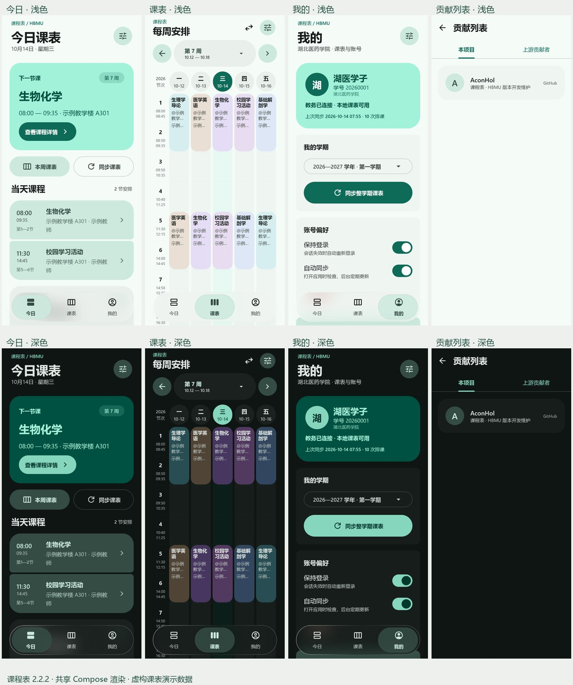

<!-- Modified by AconHol (2026): HBMU course-schedule learning project; upstream attribution retained. -->
# 课程表 · 学习项目

面向 HBMU 课表场景的个人 Android 开发学习与研究项目，基于 [拾光课程表 v2.1.0](https://github.com/ShiGuangSchedule/shiguangschedule/releases/tag/v2.1.0) 改造。保留完整上游 Git 历史、作者署名与 Apache 2.0 许可证，由 AconHol 独立维护。

> **学习用途与非官方声明**
>
> 本项目的发布目的仅为软件开发学习、技术交流与研究，不代表学校或系统运营方，不是学校官方产品，也未获得学校的官方背书。请仅处理本人有权使用的数据，并遵守适用规则和必要授权。学习用途声明不替代授权，也不免除依法应承担的责任。
>
> **开发者承诺绝不会私自盗取、收集、留存、出售或分享用户的账号、密码、姓名、课表等个人信息。应用没有开发者的数据收集服务器，不会将这些信息上传给开发者。** 账号与课表保存在用户设备；用户主动配置的备份、导出和分享由用户自己控制。

请先阅读 [完整学习用途与使用边界声明](DISCLAIMER.md)、[隐私承诺](PRIVACY.md) 与 [安全反馈说明](SECURITY.md)。公开说明不提供相关接口目录或数据获取协议教程。

## 下载

[下载 APK · GitHub Releases](https://github.com/AconHol/hbmu-schedule/releases)

Release 提供 `arm64-v8a`、`armeabi-v7a`、`x86_64` 与通用版 APK、源码包及 SHA-256 校验文件。现代 ARM64 手机使用 `arm64-v8a`，不确定架构时使用通用版；Android 模拟器可使用 `x86_64`。最低支持 Android 8.0。

首个公开版本为 `2.1.0-hbmu.4` 预发布版。构建、18 项单元测试、签名和 lint 检查已通过；Android 实机安装、权限弹窗与通知实际送达尚未完成设备验证。

## 界面

下图使用完全虚构的演示课表、账号与教师信息，由共享 Compose 页面渲染，不是 Android 实机截图。



## 功能

- Material 3 Expressive 风格，磨砂浮动底栏、浅色与深色主题。
- 今日课程、每周课表、周次切换与明日安排。
- 账号卡片、保持登录、课表更新与离线查看。
- 上课前提醒、前一晚课表预告；首次完成课表设置后主动请求通知权限。
- 保留课程编辑、课表管理、作息管理、小组件、导入导出和用户自选的备份功能。

请在作息管理中校准实际上下课时间。课程安排以学校官方信息为准，提醒不应作为唯一的上课依据。

## 隐私与数据控制

账号与课表默认保存在用户设备。保持登录的信息使用 Android Keystore 在本机加密保存，登录凭据排除在系统备份与设备迁移之外。应用不包含开发者的数据收集、统计分析或广告追踪服务。

备份与导出属于用户主动选择的功能，不会把数据交给开发者。Android 系统备份由设备设置控制；用户选择的外部服务受对应服务方的规则与隐私政策约束。上述承诺针对本仓库发布的版本，不延伸到他人修改后重新分发的软件。

## 源码与构建

需要 JDK 21、Android SDK 37 和 Gradle 9.7.1；配置本机 `local.properties` 的 SDK 路径后运行：

```powershell
.\gradlew.bat :shared:testAndroidHostTest :androidApp:assembleRelease --no-configuration-cache
```

正式 APK 在维护者本机签名。自行构建 release 时应提供自己的 `HBMU_KEYSTORE_PATH`、`HBMU_STORE_PASSWORD` 与别名 `hbmu`，否则项目使用开发调试签名，不能覆盖维护者签名的版本。维护者的签名私钥及密码不会进入仓库或 GitHub Actions。

本仓库提供手动运行的 Android 构建检查。使用说明见 [HBMU-README.md](HBMU-README.md)，改动说明见 [APP-UPDATE.md](APP-UPDATE.md)。

## 来源与许可

上游：ShiGuangSchedule/shiguangschedule，基线提交 `feabb68f75c4058319b449287980b5f645eb8d61`，v2.1.0。原作者与贡献者的版权和署名保留；本项目不是上游官方发行版。

应用源码沿用 [Apache 2.0](LICENSE)，第三方组件的版权与许可保留，详见 [NOTICE](NOTICE)。学习研究目的不额外限制开源许可证授予的合法源码权利；源码许可不授予学校系统、账号、商标或他人数据的使用权限。
